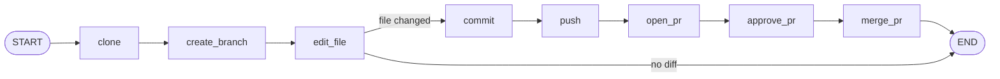
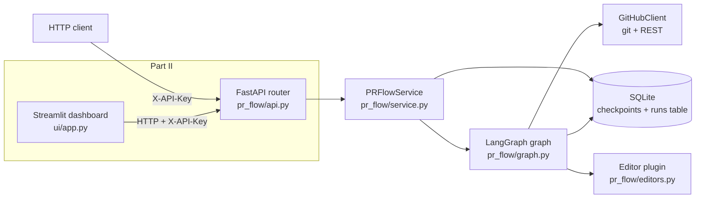
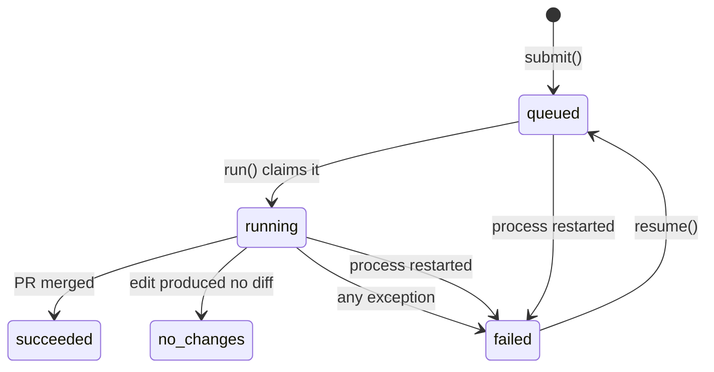

# Build a LangGraph workflow (without an LLM) that merges a GitHub PR, and a Streamlit dashboard to watch it

*Python · LangGraph · SQLite · FastAPI · Streamlit · uv · Docker*

LangGraph is usually introduced as "the framework for LLM agents", but underneath it is a small, general-purpose engine for **stateful, resumable workflows**. In this tutorial you learn it with no LLM involved at all, by building something concrete and useful in two parts.

**Part I: the workflow API.** An HTTP service that, given a GitHub repo, **clones it, creates a branch, edits a file, commits, pushes, opens a pull request, approves it with a second account, and merges it**. Progress is saved in SQLite after every step, so a failed run can resume exactly where it stopped.

**Part II: the dashboard.** A second, separate microservice with a **Streamlit** UI. It starts runs, shows every step of every run in **green** (completed), **yellow** (running) or **red** (failed), and has a button that **resumes** a failed run.

## What you will learn

- The five LangGraph ideas that matter: state, nodes, edges, reducers and checkpoints
- How to structure a workflow as a framework-agnostic **service class** with a thin **FastAPI** router
- How to expose per-step status so a UI can draw it, and how to build that UI as an independent **Streamlit** service
- How to manage both projects with **uv** and ship them with **Docker** and **Docker Compose**
- How to test the whole thing without a GitHub account

## Contents

**Part I: the workflow API**

0. [Prerequisites](#chapter-0-prerequisites)
1. [LangGraph concepts in one small script](#chapter-1-langgraph-concepts-in-one-small-script)
2. [Project setup with uv](#chapter-2-project-setup-with-uv)
3. [Build the service, file by file](#chapter-3-build-the-service-file-by-file)
4. [Run it, test it, break it, resume it](#chapter-4-run-it-test-it-break-it-resume-it)
5. [Ship the API as a Docker container](#chapter-5-ship-the-api-as-a-docker-container)

**Part II: the Streamlit dashboard**

6. [Design the dashboard](#chapter-6-design-the-dashboard)
7. [Build the UI service](#chapter-7-build-the-ui-service)
8. [Run both services and watch a run](#chapter-8-run-both-services-and-watch-a-run)
9. [Run both with Docker Compose](#chapter-9-run-both-with-docker-compose)
10. [Where to go next](#chapter-10-where-to-go-next)

[Troubleshooting](#troubleshooting)

---

# Part I: the workflow API

## What you are building

The workflow is a straight line with one branch. If the edit changes nothing, there is nothing to commit and the run ends early:



And this is how the pieces fit together (the dashed box is Part II):



The key design choice is the middle box. `PRFlowService` knows nothing about HTTP. FastAPI is a thin skin on top, so the same service can be called from a CLI, a queue worker, a test or, in Part II, a dashboard.

---

## Chapter 0: Prerequisites

**Tools**

| Tool | Why | Check |
|---|---|---|
| Python 3.11+ | runtime (uv can install it for you) | `python3 --version` |
| [uv](https://docs.astral.sh/uv/) | dependency and virtualenv management | `uv --version` |
| git | the workflow shells out to it | `git --version` |
| Docker | for [Chapter 5](#chapter-5-ship-the-api-as-a-docker-container) and [Chapter 9](#chapter-9-run-both-with-docker-compose) | `docker --version` |

Install uv if you don't have it:

```bash
curl -LsSf https://astral.sh/uv/install.sh | sh     # or: brew install uv
```

**GitHub setup (two accounts)**

GitHub does not let a user approve their own pull request, so the workflow needs **two different GitHub users**:

1. Create (or pick) a **throwaway repository**, for example `YOUR_USER/pr-flow-sandbox`, containing at least one commit. This workflow really does merge, so do not point it at anything you care about while learning.
2. Make the second user a **collaborator with write access** on that repo. (Approvals from users without write access do not count towards required reviews.)
3. Create a **fine-grained personal access token** for each user (GitHub → Settings → Developer settings → Personal access tokens → Fine-grained tokens), scoped to that one repository:

| Token | Used for | Repository permissions |
|---|---|---|
| **author** | clone, push, open PR, merge | Contents: Read and write · Pull requests: Read and write |
| **reviewer** | approve the PR | Pull requests: Read and write |

4. *Optional but recommended:* add a branch protection rule on the default branch that requires **1 approving review**. Then the approval step genuinely gates the merge, which is the whole point of having two accounts.

> **Treat PATs like passwords.** They go in environment variables only. Never paste them into code, a chat, or a commit. The design keeps them out of the workflow state, the SQLite file and `.git/config`, and, in Part II, out of the dashboard entirely. [Chapter 3](#chapter-3-build-the-service-file-by-file) explains how.

---

## Chapter 1: LangGraph concepts in one small script

Before building the real thing, here is every concept you need in about 100 lines. The script has no LLM, no network access and no GitHub: it classifies a number, branches on whether it is even, and then simulates a flaky external call so you can watch checkpointing and resume work.

The five concepts:

| Concept | What it is | In the PR workflow |
|---|---|---|
| **State** | One shared object (a `TypedDict`) that flows through the graph | repo, branch, commit SHA, PR number, a log |
| **Node** | A plain function: takes the state, returns **only the keys it changes** | `clone`, `commit`, `push`, … |
| **Edge** | A fixed link between nodes (`A → B`) | `commit → push` |
| **Conditional edge** | A function that returns which node comes next | "did the edit change anything?" |
| **Reducer** | The rule for merging a node's return value into a key: overwrite by default, or e.g. append | the `log` list |
| **Checkpointer** | Saves the state after every node, keyed by a `thread_id` | SQLite, so failed runs resume |

**`concepts_demo.py`**

```python
"""LangGraph in one file: no LLM, no network, no GitHub.

Run it:   uv run python concepts_demo.py

Covers the five ideas the PR workflow is built from:
  1. State       - one shared dict-like object passed through the graph
  2. Nodes       - plain functions: take state, return a partial update
  3. Edges       - fixed (A -> B) and conditional (A -> B or C, decided by a function)
  4. Reducers    - how a node's update is merged into a key (append vs overwrite)
  5. Checkpoints - state saved after every node, so a failed run can resume
"""
import operator
import sqlite3
from pathlib import Path
from typing import Annotated, TypedDict

from langgraph.checkpoint.sqlite import SqliteSaver
from langgraph.graph import END, START, StateGraph

DB = "concepts_demo.db"


# 1. STATE ------------------------------------------------------------------
# Keys without a reducer are OVERWRITTEN by whatever a node returns.
# `log` has a reducer (operator.add), so returned lists are APPENDED instead.
class State(TypedDict, total=False):
    n: int
    is_even: bool
    log: Annotated[list[str], operator.add]


# 2. NODES ------------------------------------------------------------------
# A node returns ONLY the keys it changes. LangGraph merges them into the state.
def classify(state: State) -> dict:
    return {"is_even": state["n"] % 2 == 0, "log": [f"classified {state['n']}"]}


def halve(state: State) -> dict:
    return {"n": state["n"] // 2, "log": ["halved"]}


def triple_plus_one(state: State) -> dict:
    return {"n": 3 * state["n"] + 1, "log": ["tripled+1"]}


attempts = {"count": 0}


def publish(state: State) -> dict:
    """Pretends to call an external system. Fails on the first attempt."""
    attempts["count"] += 1
    if attempts["count"] == 1:
        raise RuntimeError("simulated outage")
    return {"log": [f"published {state['n']}"]}


# 3. EDGES ------------------------------------------------------------------
def route(state: State) -> str:
    """A conditional edge is just a function that returns the next node's key."""
    return "halve" if state["is_even"] else "triple_plus_one"


def build(with_publish: bool = False) -> StateGraph:
    g = StateGraph(State)
    g.add_node("classify", classify)
    g.add_node("halve", halve)
    g.add_node("triple_plus_one", triple_plus_one)

    g.add_edge(START, "classify")                      # fixed edge
    g.add_conditional_edges(                           # conditional edge
        "classify", route, {"halve": "halve", "triple_plus_one": "triple_plus_one"})

    after = END
    if with_publish:
        g.add_node("publish", publish)
        g.add_edge("publish", END)
        after = "publish"
    g.add_edge("halve", after)
    g.add_edge("triple_plus_one", after)
    return g                                           # NOT runnable until .compile()


def main() -> None:
    # --- Demo 1: compile and invoke -------------------------------------------
    print("== 1. invoke ==")
    app = build().compile()
    print(app.invoke({"n": 6, "log": []}))             # even  -> halve
    print(app.invoke({"n": 7, "log": []}))             # odd   -> triple_plus_one

    # --- Demo 2: stream shows each node's update as it happens ----------------
    print("\n== 2. stream (updates) ==")
    for update in app.stream({"n": 7, "log": []}, stream_mode="updates"):
        print(update)                                  # {node_name: what_it_returned}

    # --- Demo 3: checkpoints + resume -----------------------------------------
    print("\n== 3. checkpoint + resume ==")
    for suffix in ("", "-wal", "-shm"):                # start from a clean database
        Path(DB + suffix).unlink(missing_ok=True)

    with SqliteSaver.from_conn_string(DB) as saver:
        app = build(with_publish=True).compile(checkpointer=saver)
        config = {"configurable": {"thread_id": "demo-1"}}   # thread_id = one saved run

        try:
            app.invoke({"n": 7, "log": []}, config)
        except RuntimeError as exc:
            print("run failed:", exc)

        snap = app.get_state(config)
        print("saved state:", snap.values)             # work done before the failure is kept
        print("next node  :", snap.next)               # ('publish',): where it will resume

        # Passing None as input means "continue this thread from its checkpoint".
        print("resumed    :", app.invoke(None, config))

    with sqlite3.connect(DB) as conn:
        rows = conn.execute(
            "SELECT thread_id, COUNT(*) FROM checkpoints GROUP BY thread_id").fetchall()
    print("checkpoints in SQLite:", rows)


if __name__ == "__main__":
    main()
```

Run it:

```bash
uv run python concepts_demo.py
```

(You will set up the project properly in Chapter 2; if you want to try it right now, `uv run --with langgraph --with langgraph-checkpoint-sqlite python concepts_demo.py` works in any folder.)

You should see output of this shape. Key order inside the dictionaries may differ:

```text
== 1. invoke ==
{'n': 3, 'is_even': True, 'log': ['classified 6', 'halved']}
{'n': 22, 'is_even': False, 'log': ['classified 7', 'tripled+1']}

== 2. stream (updates) ==
{'classify': {'is_even': False, 'log': ['classified 7']}}
{'triple_plus_one': {'n': 22, 'log': ['tripled+1']}}

== 3. checkpoint + resume ==
run failed: simulated outage
saved state: {'n': 22, 'is_even': False, 'log': ['classified 7', 'tripled+1']}
next node  : ('publish',)
resumed    : {'n': 22, 'is_even': False, 'log': ['classified 7', 'tripled+1', 'published 22']}
checkpoints in SQLite: [('demo-1', N)]      # N: a handful of rows, one per step
```

### What to notice

1. **`log` grows; `n` is replaced.** Both are plain returns from nodes. The difference is the `Annotated[list[str], operator.add]` reducer on `log`.
2. **A graph is a blueprint.** Nothing runs until `.compile()`. Compiling with `checkpointer=...` is what makes it durable.
3. **Demo 3 is the whole reason we use LangGraph here.** `publish` failed, but the work done before it (`classify`, `tripled+1`) was already saved. `get_state(config).next` tells you where the run is parked, and `invoke(None, config)` means "continue this thread from its last checkpoint". The `clone → … → merge_pr` workflow gets exactly this behaviour for free: if `approve_pr` fails because a token expired, you fix the token and resume at `approve_pr` without cloning, committing or opening a second PR.
4. **`get_state(...).next` is also how the dashboard knows which node is yellow or red.** A node's checkpoint is only written when it finishes, so while it runs, or after it failed, `next` still names it. Part II is built on that one fact.
5. **`thread_id` is the identity of a run.** One thread, one run. In the service it will be the run's id.

---

## Chapter 2: Project setup with uv

uv gives you a virtualenv, dependency resolution and a lockfile with a handful of commands.

If you are building from scratch:

```bash
mkdir pr-flow-service && cd pr-flow-service
uv init --bare                       # creates a minimal pyproject.toml
uv add fastapi uvicorn langgraph langgraph-checkpoint-sqlite requests
uv add --dev httpx pytest            # httpx is required by FastAPI's TestClient
```

If you downloaded the finished project, you only need:

```bash
uv sync                              # creates .venv and uv.lock from pyproject.toml
```

Either way you end up with this `pyproject.toml` for the API:

**`pyproject.toml`**

```toml
[project]
name = "pr-flow-service"
version = "0.1.0"
description = "LangGraph (no LLM) workflow that clones, edits, pushes, approves and merges a PR, exposed via FastAPI"
requires-python = ">=3.11"
dependencies = [
    "fastapi>=0.110",
    "langgraph>=0.2",
    "langgraph-checkpoint-sqlite>=2.0",
    "requests>=2.31",
    "uvicorn>=0.29",
]

[dependency-groups]
dev = [
    "httpx>=0.27",   # needed by fastapi.testclient
    "pytest>=8",
]

[tool.uv]
package = false      # an application, not a library: no build step, just `uv sync`

[tool.pytest.ini_options]
pythonpath = ["."]   # lets tests `import pr_flow` without installing the project
```

A few things worth knowing:

- **`package = false`** tells uv this is an *application*, not a library. There is nothing to build or install; `uv sync` just installs the dependencies.
- **`uv.lock`** pins every transitive dependency to an exact version. **Commit it.** The Docker builds use it for reproducible installs.
- **`uv run <cmd>`** runs a command inside the project's environment, syncing first if needed, so you rarely need to activate the virtualenv by hand.
- **`dev` dependencies** live in `[dependency-groups]` and are skipped in production images with `--no-dev`.

The project is a small monorepo: the API at the root and the dashboard (Part II) in `ui/`, **each with its own `pyproject.toml` and lockfile**, because they are separate services with separate dependencies:

```text
pr-flow-service/
├── pyproject.toml           # API dependencies
├── uv.lock                  # generated by `uv sync` / `uv lock`; commit it
├── app.py                   # example FastAPI host
├── concepts_demo.py         # Chapter 1
├── pr_flow/
│   ├── __init__.py
│   ├── config.py            # settings (holds the tokens)
│   ├── github.py            # git + GitHub REST wrapper
│   ├── editors.py           # pluggable "edit a file" step
│   ├── steps.py             # per-node status for dashboards
│   ├── graph.py             # the LangGraph workflow
│   ├── service.py           # PRFlowService: the framework-agnostic core
│   └── api.py               # optional FastAPI router
├── tests/                   # test_service.py, test_steps.py
├── Dockerfile               # API image
├── docker-compose.yml       # runs API + UI together
├── .dockerignore  .gitignore  .env.example
└── ui/                      # Part II: a separate microservice
    ├── pyproject.toml  uv.lock  Dockerfile  .env.example
    ├── app.py               # the Streamlit app
    ├── pr_flow_ui/
    │   ├── client.py        # HTTP client for the API
    │   └── view.py          # colours + HTML
    └── tests/test_ui.py
```

---

## Chapter 3: Build the service, file by file

Start with the ideas behind the design, because they explain most of the code.

1. **Secrets never enter graph state.** LangGraph persists state to SQLite after every node. If a token were in state, it would be written to disk dozens of times. Tokens live only in a `Settings` object in memory and are read by the GitHub client at call time.
2. **Every step is a separate node.** That is what makes resume granular. Where possible, nodes are written to be safe to re-run (`git checkout -B`, deleting a stale clone before cloning).
3. **Two kinds of persistence.** LangGraph's checkpointer stores *workflow state*. A small `pr_flow_runs` table stores *operational status* (queued, running, failed…) so an API can list and filter runs.
4. **The service does not know about HTTP.** The router is ~60 lines on top.
5. **The API tells clients the state of every step.** A dashboard should not have to reverse-engineer LangGraph, so the API returns a ready-made `steps` list. That is `steps.py`, below.

### 3.1 `pr_flow/config.py`: settings

**`pr_flow/config.py`**

```python
"""Configuration. Tokens live here (in memory) and never enter graph state,
so they are never written to the SQLite checkpoints."""
import os
from dataclasses import dataclass, field


@dataclass(frozen=True)
class Settings:
    author_token: str = field(repr=False)     # pushes, opens and merges the PR
    reviewer_token: str = field(repr=False)   # different GitHub user; approves the PR
    db_path: str = "pr_flow.db"
    workspace_root: str = "workspaces"
    github_api_url: str = "https://api.github.com"
    github_clone_base: str = "https://github.com"
    merge_method: str = "squash"              # squash | merge | rebase
    cleanup_on_success: bool = True           # delete the local clone after a merge
    http_timeout: int = 30

    @classmethod
    def from_env(cls) -> "Settings":
        def need(name: str) -> str:
            value = os.environ.get(name)
            if not value:
                raise RuntimeError(f"Environment variable {name} is not set")
            return value

        return cls(
            author_token=need("GH_PAT_AUTHOR"),
            reviewer_token=need("GH_PAT_REVIEWER"),
            db_path=os.environ.get("PR_FLOW_DB", "pr_flow.db"),
            workspace_root=os.environ.get("PR_FLOW_WORKSPACES", "workspaces"),
            merge_method=os.environ.get("PR_FLOW_MERGE_METHOD", "squash"),
        )
```

- `field(repr=False)` keeps the tokens out of `repr()` output, so a stray log line or traceback that prints the settings object cannot leak them.
- Everything is injectable. Tests build `Settings(...)` directly; production uses `Settings.from_env()`.

### 3.2 `pr_flow/github.py`: git and the GitHub API

**`pr_flow/github.py`**

```python
"""Thin git + GitHub REST wrapper. Swap or subclass it in tests."""
import base64
import os
import subprocess
from typing import Any, Literal

import requests

from .config import Settings

Role = Literal["author", "reviewer"]


class GitHubError(RuntimeError):
    pass


class GitHubClient:
    def __init__(self, settings: Settings):
        self.s = settings

    def _pat(self, role: Role) -> str:
        return self.s.author_token if role == "author" else self.s.reviewer_token

    def clone_url(self, repo: str) -> str:
        return f"{self.s.github_clone_base}/{repo}.git"

    def git(self, args: list[str], cwd: str | None = None, role: Role | None = None) -> str:
        """Run git. The PAT goes in a one-off HTTP header, so it is never
        written to .git/config or embedded in a remote URL."""
        cmd = ["git"]
        secret = None
        if role:
            secret = base64.b64encode(f"x-access-token:{self._pat(role)}".encode()).decode()
            cmd += ["-c", f"http.extraheader=AUTHORIZATION: basic {secret}"]
        cmd += args
        r = subprocess.run(cmd, cwd=cwd, capture_output=True, text=True,
                           env={**os.environ, "GIT_TERMINAL_PROMPT": "0"})
        if r.returncode != 0:
            err = r.stderr.strip()
            if secret:
                err = err.replace(secret, "***")
            raise GitHubError(f"git {args[0]} failed: {err}")
        return r.stdout.strip()

    def api(self, role: Role, method: str, path: str, **kwargs: Any) -> dict:
        r = requests.request(
            method, f"{self.s.github_api_url}{path}", timeout=self.s.http_timeout,
            headers={"Authorization": f"Bearer {self._pat(role)}",
                     "Accept": "application/vnd.github+json",
                     "X-GitHub-Api-Version": "2022-11-28"},
            **kwargs,
        )
        if not r.ok:
            raise GitHubError(f"GitHub {method} {path} -> {r.status_code}: {r.text[:500]}")
        return r.json()
```

- **How the token reaches git without being stored.** `git(..., role="author")` passes the PAT as a one-off `http.extraheader` for that single command. It is never written into `.git/config` or into the remote URL (a common mistake, since `https://TOKEN@github.com/...` ends up in config files and process listings). If a git command fails, the encoded secret is scrubbed from the error text before it is raised.
- **`role` picks the identity.** `"author"` or `"reviewer"` chooses which PAT to use. This is how "use another PAT to approve the PR" is implemented: one client, two roles.
- **`clone_url()` is a seam for tests.** The tests override it to point at a local bare repo.

### 3.3 `pr_flow/editors.py`: the pluggable "edit a file" step

**`pr_flow/editors.py`**

```python
"""Pluggable "edit a file" step.

An editor is `fn(workdir: Path, params: dict) -> None`. Register your own via
PRFlowService(settings, editors={"my_editor": fn}); callers then pick it with
{"editor": "my_editor", "params": {...}} in the request. Params are stored in
graph state, so they must be JSON-serialisable and must not contain secrets.
"""
from datetime import datetime, timezone
from pathlib import Path
from typing import Any, Callable

Editor = Callable[[Path, dict[str, Any]], None]


def append_line(workdir: Path, params: dict[str, Any]) -> None:
    """params: file_path (required, relative), text (optional)."""
    rel = params.get("file_path")
    if not rel:
        raise ValueError("append_line requires params.file_path")
    root = workdir.resolve()
    target = (root / rel).resolve()
    if not target.is_relative_to(root) or target.relative_to(root).parts[:1] == (".git",):
        raise ValueError(f"file_path escapes the repository: {rel}")
    text = params.get("text") or (
        f"Edited by pr_flow at {datetime.now(timezone.utc).isoformat(timespec='seconds')}")
    target.parent.mkdir(parents=True, exist_ok=True)
    with target.open("a", encoding="utf-8") as f:
        f.write(text.rstrip("\n") + "\n")


DEFAULT_EDITORS: dict[str, Editor] = {"append_line": append_line}
```

An editor is any `fn(workdir: Path, params: dict) -> None`. The built-in `append_line` appends a line to a file. To plug in your own (bump a version, regenerate a file, apply a template), register it:

```python
service = PRFlowService(Settings.from_env(), editors={"bump_version": my_function})
```

and select it per request with `{"editor": "bump_version", "params": {...}}`. Note the **path-traversal guard**: since `file_path` arrives from an HTTP caller, `../../etc/passwd` and `.git/config` are rejected.

### 3.4 `pr_flow/steps.py`: per-node status

**`pr_flow/steps.py`**

```python
"""Per-node status for dashboards.

Pure functions: no LangGraph, FastAPI or database imports, so they are trivial
to test and to reuse. The dashboard needs to answer "which node is green, which
is yellow, which is red?", and this module derives that from three facts the
service already has: the run's status, LangGraph's `next` pointer, and the log.

How a node's state is derived
-----------------------------
LangGraph's checkpoint records the node that will run *next*. While a node is
executing, or after it failed, that pointer still names it, because a node's
checkpoint is only written when it finishes. So:

    nodes before `next`       -> completed
    the node `next` points at -> running (if the run is executing)
                                 failed  (if the run failed)
    nodes after it            -> pending
    run finished, no diff     -> nodes after `edit_file` are skipped
    run succeeded             -> everything completed
"""
from typing import Any

# Must match the order nodes are wired in graph.py (graph.build_graph asserts it).
NODE_ORDER: tuple[str, ...] = (
    "clone", "create_branch", "edit_file", "commit",
    "push", "open_pr", "approve_pr", "merge_pr",
)

# Possible values of a step's "state".
COMPLETED, RUNNING, FAILED, PENDING, SKIPPED = (
    "completed", "running", "failed", "pending", "skipped")


def compute_steps(run_status: str, next_steps: list[str], log: list[str],
                  error: str | None) -> list[dict[str, Any]]:
    """Return one {"name", "state", "detail"} dict per node, in execution order.

    `detail` is the node's log line once it has completed, and the run's error
    message for the node that failed. Every node appends exactly one log line,
    so log[i] belongs to NODE_ORDER[i].
    """
    if run_status == "succeeded":
        done = len(NODE_ORDER)
    elif run_status == "no_changes":
        done = NODE_ORDER.index("edit_file") + 1
    elif next_steps and next_steps[0] in NODE_ORDER:
        done = NODE_ORDER.index(next_steps[0])
    else:                                  # no usable pointer: fall back to the log
        done = min(len(log), len(NODE_ORDER))

    steps: list[dict[str, Any]] = []
    for i, name in enumerate(NODE_ORDER):
        detail = log[i] if i < done and i < len(log) else None
        if i < done:
            state = COMPLETED
        elif run_status == "no_changes":
            state = SKIPPED
        elif i == done and run_status == "running":
            state = RUNNING
        elif i == done and run_status == "failed":
            state, detail = FAILED, error
        else:
            state = PENDING
        steps.append({"name": name, "state": state, "detail": detail})
    return steps
```

This file is the bridge to Part II. It answers "which node is green, yellow or red?" as a **pure function** with no LangGraph, FastAPI or database imports:

- The rule is in the docstring: nodes before LangGraph's `next` pointer are `completed`; the node it points at is `running` or `failed` depending on the run's status; later nodes are `pending`.
- A run that ended because the edit changed nothing marks the rest `skipped`.
- If there is no usable pointer yet, it falls back to counting log lines, because every node appends exactly one.
- Because it is pure, it has its own fast tests (`tests/test_steps.py`) that need no GitHub, no database and no LangGraph.

### 3.5 `pr_flow/graph.py`: the workflow

**`pr_flow/graph.py`**

```python
"""The LangGraph workflow (no LLM). Nodes are closures over a GitHubClient."""
import operator
import shutil
from pathlib import Path
from typing import Annotated, Any, TypedDict

from langgraph.graph import END, START, StateGraph

from .editors import Editor
from .github import GitHubClient
from .steps import NODE_ORDER


class FlowState(TypedDict, total=False):
    repo: str
    workdir: str
    branch: str
    base_branch: str
    editor: str
    params: dict[str, Any]
    changed: bool
    commit_sha: str
    pr_number: int
    pr_url: str
    merged: bool
    log: Annotated[list[str], operator.add]   # reducer: node returns append


def build_graph(gh: GitHubClient, editors: dict[str, Editor]) -> StateGraph:
    def clone(s: FlowState) -> dict:
        workdir = Path(s["workdir"])
        if workdir.exists():                  # keeps the node safe to re-run
            shutil.rmtree(workdir)
        workdir.parent.mkdir(parents=True, exist_ok=True)
        gh.git(["clone", gh.clone_url(s["repo"]), str(workdir)], role="author")
        base = gh.api("author", "GET", f"/repos/{s['repo']}")["default_branch"]
        return {"base_branch": base, "log": [f"cloned, base={base}"]}

    def create_branch(s: FlowState) -> dict:
        gh.git(["checkout", "-B", s["branch"]], cwd=s["workdir"])
        return {"log": [f"created branch {s['branch']}"]}

    def edit_file(s: FlowState) -> dict:
        editors[s["editor"]](Path(s["workdir"]), s.get("params") or {})
        changed = bool(gh.git(["status", "--porcelain"], cwd=s["workdir"]))
        return {"changed": changed, "log": [f"edited (changed={changed})"]}

    def commit(s: FlowState) -> dict:
        me = gh.api("author", "GET", "/user")
        email = f"{me['id']}+{me['login']}@users.noreply.github.com"
        gh.git(["add", "-A"], cwd=s["workdir"])
        gh.git(["-c", f"user.name={me['login']}", "-c", f"user.email={email}",
                "commit", "-m", f"pr_flow: update via {s['branch']}"], cwd=s["workdir"])
        sha = gh.git(["rev-parse", "HEAD"], cwd=s["workdir"])
        return {"commit_sha": sha, "log": [f"committed {sha[:8]}"]}

    def push(s: FlowState) -> dict:
        gh.git(["push", "-u", "origin", s["branch"]], cwd=s["workdir"], role="author")
        return {"log": [f"pushed {s['branch']}"]}

    def open_pr(s: FlowState) -> dict:
        pr = gh.api("author", "POST", f"/repos/{s['repo']}/pulls",
                    json={"title": f"pr_flow: {s['branch']}", "head": s["branch"],
                          "base": s["base_branch"], "body": "Opened by an automated workflow."})
        return {"pr_number": pr["number"], "pr_url": pr["html_url"],
                "log": [f"opened PR #{pr['number']}"]}

    def approve_pr(s: FlowState) -> dict:
        # Must be a different user than the author: GitHub rejects self-approval.
        gh.api("reviewer", "POST", f"/repos/{s['repo']}/pulls/{s['pr_number']}/reviews",
               json={"event": "APPROVE", "body": "Approved by automated reviewer."})
        return {"log": [f"approved PR #{s['pr_number']}"]}

    def merge_pr(s: FlowState) -> dict:
        res = gh.api("author", "PUT", f"/repos/{s['repo']}/pulls/{s['pr_number']}/merge",
                     json={"merge_method": gh.s.merge_method})
        return {"merged": bool(res.get("merged")), "log": [f"merged PR #{s['pr_number']}"]}

    def after_edit(s: FlowState) -> str:
        return "commit" if s.get("changed") else END

    nodes = (clone, create_branch, edit_file, commit, push, open_pr, approve_pr, merge_pr)
    # The dashboard colours nodes by this order; fail loudly if the two drift apart.
    assert tuple(fn.__name__ for fn in nodes) == NODE_ORDER, "keep steps.NODE_ORDER in sync"

    g = StateGraph(FlowState)
    for fn in nodes:
        g.add_node(fn.__name__, fn)
    g.add_edge(START, "clone")
    g.add_edge("clone", "create_branch")
    g.add_edge("create_branch", "edit_file")
    g.add_conditional_edges("edit_file", after_edit, {"commit": "commit", END: END})
    g.add_edge("commit", "push")
    g.add_edge("push", "open_pr")
    g.add_edge("open_pr", "approve_pr")
    g.add_edge("approve_pr", "merge_pr")
    g.add_edge("merge_pr", END)
    return g
```

Read this file against Chapter 1; every concept appears:

- `FlowState` is the **state**; `log` has the append **reducer**.
- Each inner function is a **node**. It returns only what it changed.
- `after_edit` is the **conditional edge**: no diff → `END`, otherwise `commit`.
- `build_graph` returns an uncompiled `StateGraph`. The service compiles it with the SQLite checkpointer.
- `approve_pr` uses `"reviewer"`; every other GitHub call uses `"author"`.
- Nodes receive `gh` and `editors` through a closure rather than a global, so the tests can inject fakes.
- The `assert` on `NODE_ORDER` makes the graph and the dashboard's idea of the pipeline fail loudly if they ever drift apart, for example if you add a node and forget `steps.py`.

### 3.6 `pr_flow/service.py`: the core

**`pr_flow/service.py`**

```python
"""PRFlowService: the framework-agnostic entry point. No FastAPI imports here,
so you can call it from a CLI, a worker or a test just as easily.

Lifecycle of a run (table pr_flow_runs):
    queued -> running -> succeeded | no_changes | failed
    failed -> queued (via resume) -> running -> ...
Graph state (per-node checkpoints) lives in the same SQLite file, managed by
LangGraph's SqliteSaver. The runs table is a small index on top for status/listing.
"""
import json
import shutil
import sqlite3
import threading
import uuid
from pathlib import Path
from typing import Any

from langgraph.checkpoint.sqlite import SqliteSaver

from .config import Settings
from .editors import DEFAULT_EDITORS, Editor
from .github import GitHubClient
from .graph import build_graph
from .steps import compute_steps

_SCHEMA = """
CREATE TABLE IF NOT EXISTS pr_flow_runs (
    thread_id  TEXT PRIMARY KEY,
    repo       TEXT NOT NULL,
    request    TEXT NOT NULL,
    status     TEXT NOT NULL,
    error      TEXT,
    created_at TEXT NOT NULL DEFAULT (strftime('%Y-%m-%dT%H:%M:%fZ','now')),
    updated_at TEXT NOT NULL DEFAULT (strftime('%Y-%m-%dT%H:%M:%fZ','now'))
)"""


class NotFound(Exception):
    pass


class Conflict(Exception):
    pass


class PRFlowService:
    def __init__(self, settings: Settings, editors: dict[str, Editor] | None = None,
                 github: GitHubClient | None = None):
        self.settings = settings
        self.editors = {**DEFAULT_EDITORS, **(editors or {})}

        # Separate connections: one for LangGraph checkpoints, one for the runs
        # table, so a commit on one can never split a transaction on the other.
        def connect() -> sqlite3.Connection:
            c = sqlite3.connect(settings.db_path, check_same_thread=False, timeout=30)
            c.execute("PRAGMA journal_mode=WAL")
            return c

        self._saver_conn = connect()
        self._conn = connect()
        self._lock = threading.Lock()
        self._conn.execute(_SCHEMA)
        self._conn.commit()

        self._graph = build_graph(github or GitHubClient(settings), self.editors).compile(
            checkpointer=SqliteSaver(self._saver_conn))

        # Background tasks die with the process; make interrupted runs resumable.
        self._exec("UPDATE pr_flow_runs SET status='failed', error='interrupted by restart', "
                   "updated_at=strftime('%Y-%m-%dT%H:%M:%fZ','now') "
                   "WHERE status IN ('queued','running')")

    # ------------------------------------------------------------ public API
    def submit(self, repo: str, editor: str = "append_line",
               params: dict[str, Any] | None = None) -> str:
        """Register a run and return its id. Call run(id) to execute it."""
        if editor not in self.editors:
            raise ValueError(f"unknown editor {editor!r}; available: {sorted(self.editors)}")
        thread_id = uuid.uuid4().hex[:12]
        request = {"repo": repo, "editor": editor, "params": params or {}}
        self._exec("INSERT INTO pr_flow_runs (thread_id, repo, request, status) "
                   "VALUES (?, ?, ?, 'queued')", (thread_id, repo, json.dumps(request)))
        return thread_id

    def resume(self, thread_id: str) -> None:
        """Re-queue a failed run. Call run(id) afterwards to execute it."""
        row = self._row(thread_id)
        if row["status"] != "failed":
            raise Conflict(f"run is {row['status']}; only failed runs can be resumed")
        if not self._claim(thread_id, "failed", "queued"):
            raise Conflict("run changed state; try again")

    def run(self, thread_id: str) -> None:
        """Blocking. Executes (or continues) the graph. Never raises: outcomes
        are recorded in the runs table. Run it in a thread/worker."""
        if not self._claim(thread_id, "queued", "running"):
            return                                   # someone else has it
        config = {"configurable": {"thread_id": thread_id}}
        try:
            snap = self._graph.get_state(config)
            if snap.values:                          # checkpoint exists -> continue
                initial = None
            else:                                    # fresh run
                req = json.loads(self._row(thread_id)["request"])
                initial = {**req,
                           "workdir": str(Path(self.settings.workspace_root) / thread_id),
                           "branch": f"pr-flow/{thread_id}", "log": []}
            for _ in self._graph.stream(initial, config, stream_mode="updates"):
                self._exec("UPDATE pr_flow_runs SET updated_at=strftime('%Y-%m-%dT%H:%M:%fZ','now') "
                           "WHERE thread_id=?", (thread_id,))
            values = self._graph.get_state(config).values
            if values.get("merged"):
                self._finish(thread_id, "succeeded")
                if self.settings.cleanup_on_success:
                    shutil.rmtree(values["workdir"], ignore_errors=True)
            elif values.get("changed") is False:
                self._finish(thread_id, "no_changes")
            else:
                self._finish(thread_id, "failed", "finished without merging")
        except Exception as exc:                     # noqa: BLE001
            self._finish(thread_id, "failed", f"{type(exc).__name__}: {exc}"[:2000])

    def get(self, thread_id: str) -> dict[str, Any]:
        row = self._row(thread_id)
        snap = self._graph.get_state({"configurable": {"thread_id": thread_id}})
        v = snap.values or {}
        next_steps = list(snap.next)
        log = v.get("log", [])
        return {
            "thread_id": thread_id, "repo": row["repo"], "status": row["status"],
            "error": row["error"], "created_at": row["created_at"],
            "updated_at": row["updated_at"], "next_steps": next_steps,
            # One entry per node (completed/running/failed/pending/skipped): this is
            # what a dashboard colours green/yellow/red.
            "steps": compute_steps(row["status"], next_steps, log, row["error"]),
            "branch": v.get("branch"), "commit_sha": v.get("commit_sha"),
            "pr_number": v.get("pr_number"), "pr_url": v.get("pr_url"),
            "merged": v.get("merged", False), "log": log,
        }

    def list(self, limit: int = 50) -> list[dict[str, Any]]:
        with self._lock:
            rows = self._conn.execute(
                "SELECT thread_id, repo, status, error, created_at, updated_at "
                "FROM pr_flow_runs ORDER BY created_at DESC LIMIT ?", (limit,)).fetchall()
        keys = ("thread_id", "repo", "status", "error", "created_at", "updated_at")
        return [dict(zip(keys, r)) for r in rows]

    def editor_names(self) -> list[str]:
        return sorted(self.editors)

    def close(self) -> None:
        self._conn.close()
        self._saver_conn.close()

    # ------------------------------------------------------------ internals
    def _exec(self, sql: str, args: tuple = ()) -> int:
        with self._lock:
            cur = self._conn.execute(sql, args)
            self._conn.commit()
            return cur.rowcount

    def _claim(self, thread_id: str, from_status: str, to_status: str) -> bool:
        """Atomic compare-and-set; the guard against double execution."""
        return self._exec(
            "UPDATE pr_flow_runs SET status=?, error=NULL, "
            "updated_at=strftime('%Y-%m-%dT%H:%M:%fZ','now') WHERE thread_id=? AND status=?",
            (to_status, thread_id, from_status)) == 1

    def _finish(self, thread_id: str, status: str, error: str | None = None) -> None:
        self._exec("UPDATE pr_flow_runs SET status=?, error=?, "
                   "updated_at=strftime('%Y-%m-%dT%H:%M:%fZ','now') WHERE thread_id=?",
                   (status, error, thread_id))

    def _row(self, thread_id: str) -> dict[str, Any]:
        with self._lock:
            r = self._conn.execute(
                "SELECT repo, request, status, error, created_at, updated_at "
                "FROM pr_flow_runs WHERE thread_id=?", (thread_id,)).fetchone()
        if not r:
            raise NotFound(thread_id)
        return dict(zip(("repo", "request", "status", "error", "created_at", "updated_at"), r))
```

This is the most important file. Walk through it in four parts:

**The run state machine**



**`_claim()` is a compare-and-set.** `UPDATE … WHERE status = 'queued'` succeeds for exactly one caller. If two requests try to resume the same run, only one gets `rowcount == 1`; the other returns immediately. This is what prevents the same workflow from running twice at once.

**`run()` handles both new runs and resumes with the same code.** It asks the checkpointer whether state already exists for this `thread_id`. If yes, it passes `None` as input (continue from checkpoint, exactly like Chapter 1, demo 3). If not, it builds the initial state. It never raises: all outcomes are written to the runs table, because it is called from a background thread where nobody would catch an exception.

**Two SQLite connections.** One belongs to LangGraph's `SqliteSaver`, the other to the runs table. Sharing a single connection would let a `commit()` from one side finalise a half-written transaction from the other. WAL mode lets both coexist on one file.

**Restart recovery.** Background tasks vanish when the process dies. On startup, anything left `queued` or `running` is marked `failed` ("interrupted by restart"), which makes it resumable.

**Cleanup only on success.** The local clone is deleted only after a successful merge, because a resumed run may still need it (for example, resuming at `push`).

**`get()` returns `steps`.** It combines the run's status, the checkpoint's `next` pointer and the log through `compute_steps`, so every client sees the same per-node colours.

### 3.7 `pr_flow/api.py`: the FastAPI router

**`pr_flow/api.py`**

```python
"""Optional FastAPI router. Mount it in any app:

    app.include_router(create_router(service, dependencies=[Depends(my_auth)]),
                       prefix="/pr-flows")
"""
from typing import Any, Sequence

from fastapi import APIRouter, BackgroundTasks, HTTPException, status
from pydantic import BaseModel, Field

from .service import Conflict, NotFound, PRFlowService


class StartRequest(BaseModel):
    repo: str = Field(pattern=r"^[A-Za-z0-9_.-]+/[A-Za-z0-9_.-]+$",
                      examples=["octocat/hello-world"])
    editor: str = "append_line"
    params: dict[str, Any] = Field(default_factory=dict,
                                   examples=[{"file_path": "NOTES.md", "text": "hello"}])


class Accepted(BaseModel):
    thread_id: str
    status: str


def create_router(service: PRFlowService, dependencies: Sequence[Any] | None = None) -> APIRouter:
    router = APIRouter(tags=["pr-flows"], dependencies=list(dependencies or []))

    @router.post("", status_code=status.HTTP_202_ACCEPTED, response_model=Accepted)
    def start(req: StartRequest, bg: BackgroundTasks):
        try:
            thread_id = service.submit(req.repo, req.editor, req.params)
        except ValueError as exc:
            raise HTTPException(422, str(exc))
        bg.add_task(service.run, thread_id)        # sync fn -> runs in the threadpool
        return Accepted(thread_id=thread_id, status="queued")

    @router.get("")
    def list_runs(limit: int = 50):
        return service.list(limit=min(limit, 200))

    # Declared BEFORE "/{thread_id}": FastAPI matches routes in order, and
    # "editors" would otherwise be captured as a thread id.
    @router.get("/editors")
    def list_editors():
        return service.editor_names()

    @router.get("/{thread_id}")
    def get_run(thread_id: str):
        try:
            return service.get(thread_id)
        except NotFound:
            raise HTTPException(404, "run not found")

    @router.post("/{thread_id}/resume", status_code=status.HTTP_202_ACCEPTED,
                 response_model=Accepted)
    def resume(thread_id: str, bg: BackgroundTasks):
        try:
            service.resume(thread_id)
        except NotFound:
            raise HTTPException(404, "run not found")
        except Conflict as exc:
            raise HTTPException(409, str(exc))
        bg.add_task(service.run, thread_id)
        return Accepted(thread_id=thread_id, status="queued")

    return router
```

- `POST` returns **202 Accepted** immediately with an id. The workflow takes seconds to minutes; the caller polls `GET /{id}`.
- The route handlers are plain `def`, not `async def`, and `service.run` is a blocking function. FastAPI runs both in a threadpool, so git and `requests` never block the event loop.
- `create_router(service, dependencies=[...])` takes your auth dependencies, so you mount it into an app with whatever authentication you already use.
- Domain errors map to HTTP: unknown id → 404, resuming a non-failed run → 409, unknown editor or malformed repo → 422.
- `GET /editors` lists the registered editors so a UI can offer them in a dropdown. It is declared **before** `/{thread_id}`: FastAPI matches routes in order, so otherwise `"editors"` would be captured as a thread id.

### 3.8 `app.py` and `pr_flow/__init__.py`

**`app.py`**

```python
"""Example host app.

    export GH_PAT_AUTHOR=... GH_PAT_REVIEWER=... PR_FLOW_API_KEY=some-long-random-string
    uvicorn app:app            # keep to ONE worker: background runs live in process memory

    curl -X POST localhost:8000/pr-flows -H "X-API-Key: $PR_FLOW_API_KEY" \
         -H "content-type: application/json" \
         -d '{"repo":"owner/name","params":{"file_path":"NOTES.md"}}'
    curl localhost:8000/pr-flows/<thread_id> -H "X-API-Key: $PR_FLOW_API_KEY"

This API merges code using server-side tokens, so it is authenticated and
refuses to start without PR_FLOW_API_KEY.
"""
import hmac
import os
from contextlib import asynccontextmanager

from fastapi import Depends, FastAPI, Header, HTTPException

from pr_flow import PRFlowService, Settings
from pr_flow.api import create_router


def create_app() -> FastAPI:
    api_key = os.environ.get("PR_FLOW_API_KEY")
    if not api_key:
        raise RuntimeError("PR_FLOW_API_KEY must be set")

    def require_key(x_api_key: str = Header(default="")) -> None:
        # Compare bytes: compare_digest raises TypeError on non-ASCII str.
        if not hmac.compare_digest(x_api_key.encode(), api_key.encode()):
            raise HTTPException(401, "invalid API key")

    service = PRFlowService(Settings.from_env())

    @asynccontextmanager
    async def lifespan(_: FastAPI):
        yield
        service.close()

    app = FastAPI(title="PR flow", lifespan=lifespan)

    @app.get("/healthz")                      # unauthenticated, for Docker/K8s probes
    def healthz() -> dict:
        return {"ok": True}

    app.include_router(create_router(service, dependencies=[Depends(require_key)]),
                       prefix="/pr-flows")
    return app


app = create_app()
```

**`pr_flow/__init__.py`**

```python
from .config import Settings
from .editors import Editor
from .github import GitHubClient, GitHubError
from .service import Conflict, NotFound, PRFlowService

__all__ = ["Settings", "Editor", "GitHubClient", "GitHubError",
           "PRFlowService", "NotFound", "Conflict"]
```

- This API merges code using server-side credentials, so it **fails closed**: the app refuses to start without `PR_FLOW_API_KEY`. The key comparison uses `hmac.compare_digest` (constant time) on bytes.
- `/healthz` is deliberately unauthenticated so Docker and orchestrators can probe it.
- **Use one worker.** Background runs live in process memory, and the startup recovery would mark another worker's live runs as failed. Scale with a real queue later (see [Chapter 10](#chapter-10-where-to-go-next)).

---

## Chapter 4: Run it, test it, break it, resume it

### 4.1 Configure

```bash
cp .env.example .env
# edit .env: GH_PAT_AUTHOR, GH_PAT_REVIEWER, PR_FLOW_API_KEY (openssl rand -hex 32)
# and PR_FLOW_UI_PASSWORD (used in Part II)
```

**`.env.example`**

```bash
# Copy to .env and fill in. .env is git-ignored and docker-ignored. Never commit real tokens.
# Docker Compose reads this file automatically and hands each service only what it needs.

# --- API service -------------------------------------------------------------
# Fine-grained PAT for the account that pushes, opens and merges the PR:
#   Repository permissions: Contents: Read and write, Pull requests: Read and write
GH_PAT_AUTHOR=

# Fine-grained PAT for a DIFFERENT GitHub user (GitHub rejects self-approval).
# That user needs write access to the repo. Permission: Pull requests: Read and write
GH_PAT_REVIEWER=

# --- Shared by the API and the UI ----------------------------------------------
# Secret callers send as the X-API-Key header. Generate with: openssl rand -hex 32
PR_FLOW_API_KEY=

# --- UI service (Streamlit dashboard) -----------------------------------------------
# Password for the dashboard itself. Anyone who can open the UI can start merges.
PR_FLOW_UI_PASSWORD=

# Optional
# PR_FLOW_DB=pr_flow.db
# PR_FLOW_WORKSPACES=workspaces
# PR_FLOW_MERGE_METHOD=squash
# PR_FLOW_UI_REFRESH_SECONDS=3
# PR_FLOW_API_URL=http://localhost:8000      # UI -> API address when not using Compose
```

`.env` is listed in both `.gitignore` and `.dockerignore`. Keep it that way.

### 4.2 Start the server

```bash
uv run --env-file .env uvicorn app:app
```

(No `--reload`: the workflow clones repositories into `workspaces/`, and if a cloned repo contains `.py` files the reloader would restart the server mid-run.)

Open <http://localhost:8000/docs> for the interactive API documentation. Check health:

```bash
curl -s localhost:8000/healthz        # {"ok":true}
```

### 4.3 Start a run

```bash
KEY=$(grep '^PR_FLOW_API_KEY=' .env | cut -d= -f2)

curl -s -X POST localhost:8000/pr-flows \
  -H "X-API-Key: $KEY" -H "content-type: application/json" \
  -d '{"repo": "YOUR_USER/pr-flow-sandbox",
       "params": {"file_path": "NOTES.md", "text": "hello from pr_flow"}}'
```

```json
{"thread_id": "3f9c1a7be2d4", "status": "queued"}
```

Poll it:

```bash
curl -s localhost:8000/pr-flows/3f9c1a7be2d4 -H "X-API-Key: $KEY"
```

```json
{
  "thread_id": "3f9c1a7be2d4",
  "repo": "YOUR_USER/pr-flow-sandbox",
  "status": "succeeded",
  "error": null,
  "next_steps": [],
  "steps": [
    {"name": "clone",         "state": "completed", "detail": "cloned, base=main"},
    {"name": "create_branch", "state": "completed", "detail": "created branch pr-flow/3f9c1a7be2d4"},
    {"name": "edit_file",     "state": "completed", "detail": "edited (changed=True)"},
    "... commit, push, open_pr, approve_pr ...",
    {"name": "merge_pr",      "state": "completed", "detail": "merged PR #42"}
  ],
  "branch": "pr-flow/3f9c1a7be2d4",
  "commit_sha": "…",
  "pr_number": 42,
  "pr_url": "https://github.com/YOUR_USER/pr-flow-sandbox/pull/42",
  "merged": true,
  "log": ["cloned, base=main", "created branch pr-flow/3f9c1a7be2d4", "…"]
}
```

(The `"... commit, push ..."` line is an abbreviation for this page; the real response has all eight step objects.)

### 4.4 Look inside SQLite

```bash
sqlite3 pr_flow.db "SELECT thread_id, status, error FROM pr_flow_runs;"
sqlite3 pr_flow.db "SELECT thread_id, COUNT(*) AS checkpoints FROM checkpoints GROUP BY thread_id;"
```

The first table is the operational index you created; the second is LangGraph's own, with one row per node executed.

### 4.5 Break it on purpose, then resume

This is the payoff. (Part II lets you do the same thing by clicking.) Make the approval step fail:

1. Stop the server, temporarily set an **invalid reviewer token** in `.env` (`GH_PAT_REVIEWER=bad`), and start it again.
2. Start a run. It will clone, branch, edit, commit, push and open a PR, then fail at `approve_pr`.
3. `GET /pr-flows/<id>` shows `"status": "failed"`, an `error` mentioning the 401, and `"next_steps": ["approve_pr"]`. In `steps`, the first six entries are `completed`, `approve_pr` is `failed` and `merge_pr` is `pending`.
4. Put the correct token back in `.env` and restart the server. (Settings are read at startup, so a token change needs a restart. A restart also marks any in-flight runs failed, which is fine here: it was already failed.)
5. Resume:

```bash
curl -s -X POST localhost:8000/pr-flows/<id>/resume -H "X-API-Key: $KEY"
```

The run continues from `approve_pr`. Look at your repo: there is **one** PR, not two, and no second clone happened. That is checkpointing doing its job.

### 4.6 Automated tests (no GitHub needed)

The service tests use **real git** against a local bare repository and replace only GitHub's REST API with a fake. They check the happy path, the right token being used for each call, failure-then-resume without repeating steps (including the red/green step states), the no-diff early exit, and the REST status codes.

**`tests/test_service.py`**

```python
"""Tests that need no GitHub account: real git against a local bare repo,
GitHub's REST API replaced by a fake.   Run: uv run pytest -q"""
import subprocess
from pathlib import Path

import pytest
from fastapi import FastAPI
from fastapi.testclient import TestClient

from pr_flow import GitHubClient, GitHubError, PRFlowService, Settings
from pr_flow.api import create_router


class FakeGitHub(GitHubClient):
    """Real `git` against a local remote; canned answers for the REST calls."""

    def __init__(self, settings: Settings, remote: Path, fail_approve: bool = False):
        super().__init__(settings)
        self.remote = remote
        self.fail_approve = fail_approve
        self.calls: list[tuple[str, str, str]] = []       # (role, method, path)

    def clone_url(self, repo: str) -> str:
        return str(self.remote)

    def api(self, role, method, path, **kwargs):
        self.calls.append((role, method, path))
        if path == "/user":
            return {"id": 1, "login": "tester"}
        if method == "POST" and path.endswith("/pulls"):
            return {"number": 1, "html_url": "http://example.test/pull/1"}
        if path.endswith("/reviews"):
            if self.fail_approve:
                raise GitHubError("simulated approve failure")
            return {}
        if path.endswith("/merge"):
            return {"merged": True}
        return {"default_branch": "main"}                 # GET /repos/{repo}


@pytest.fixture
def remote(tmp_path: Path) -> Path:
    bare = tmp_path / "remote.git"
    subprocess.run(["git", "init", "-q", "--bare", "-b", "main", str(bare)], check=True)
    seed = tmp_path / "seed"
    subprocess.run(["git", "clone", "-q", str(bare), str(seed)], check=True, capture_output=True)
    (seed / "README.md").write_text("hello\n")

    def git(*args: str) -> None:
        subprocess.run(["git", "-c", "user.name=t", "-c", "user.email=t@t", *args],
                       cwd=seed, check=True, capture_output=True)

    git("add", "-A")
    git("commit", "-qm", "init")
    git("push", "-q", "origin", "HEAD:main")
    return bare


def make_service(tmp_path: Path, remote: Path, editors=None, **fake_kwargs):
    settings = Settings(author_token="a", reviewer_token="r",
                        db_path=str(tmp_path / "test.db"),
                        workspace_root=str(tmp_path / "ws"))
    fake = FakeGitHub(settings, remote, **fake_kwargs)
    return PRFlowService(settings, editors=editors, github=fake), fake


def count(fake: FakeGitHub, method: str, suffix: str) -> int:
    return sum(1 for _, m, p in fake.calls if m == method and p.endswith(suffix))


def test_happy_path(tmp_path, remote):
    svc, fake = make_service(tmp_path, remote)
    tid = svc.submit("o/r", params={"file_path": "NOTES.md"})
    svc.run(tid)
    run = svc.get(tid)
    assert run["status"] == "succeeded"
    assert run["merged"] and run["pr_number"] == 1
    # the approval must come from the reviewer token, everything else from the author
    assert [r for r, _, p in fake.calls if p.endswith("/reviews")] == ["reviewer"]
    assert [r for r, _, p in fake.calls if p.endswith("/merge")] == ["author"]


def test_failure_then_resume_does_not_repeat_earlier_steps(tmp_path, remote):
    svc, fake = make_service(tmp_path, remote, fail_approve=True)
    tid = svc.submit("o/r", params={"file_path": "NOTES.md"})
    svc.run(tid)
    run = svc.get(tid)
    assert run["status"] == "failed"
    assert run["next_steps"] == ["approve_pr"]
    # what the dashboard colours: green up to the failure, red on it, grey after it
    assert [s["state"] for s in run["steps"]] == ["completed"] * 6 + ["failed", "pending"]
    assert "simulated approve failure" in run["steps"][6]["detail"]

    fake.fail_approve = False
    svc.resume(tid)
    svc.run(tid)
    run = svc.get(tid)
    assert run["status"] == "succeeded"
    assert {s["state"] for s in run["steps"]} == {"completed"}
    assert count(fake, "POST", "/pulls") == 1             # PR opened exactly once


def test_no_diff_stops_without_a_pr(tmp_path, remote):
    svc, fake = make_service(tmp_path, remote, editors={"noop": lambda workdir, params: None})
    tid = svc.submit("o/r", editor="noop")
    svc.run(tid)
    run = svc.get(tid)
    assert run["status"] == "no_changes"
    assert [s["state"] for s in run["steps"]] == ["completed"] * 3 + ["skipped"] * 5
    assert count(fake, "POST", "/pulls") == 0


def test_unknown_editor_is_rejected(tmp_path, remote):
    svc, _ = make_service(tmp_path, remote)
    with pytest.raises(ValueError):
        svc.submit("o/r", editor="nope")


def test_rest_endpoints(tmp_path, remote):
    svc, _ = make_service(tmp_path, remote)
    app = FastAPI()
    app.include_router(create_router(svc), prefix="/pr-flows")
    client = TestClient(app)                              # runs background tasks inline

    r = client.post("/pr-flows", json={"repo": "o/r", "params": {"file_path": "NOTES.md"}})
    assert r.status_code == 202
    tid = r.json()["thread_id"]
    run = client.get(f"/pr-flows/{tid}").json()
    assert run["status"] == "succeeded"
    assert len(run["steps"]) == 8
    assert client.get("/pr-flows/editors").json() == ["append_line"]   # not captured by /{id}
    assert client.get("/pr-flows/does-not-exist").status_code == 404
    assert client.post("/pr-flows", json={"repo": "not a repo"}).status_code == 422
    assert client.post(f"/pr-flows/{tid}/resume").status_code == 409   # only failed runs resume
```

The step-status rules have their own pure tests:

**`tests/test_steps.py`**

```python
"""Pure tests for the per-node status logic. No GitHub, no LangGraph needed."""
from pr_flow.steps import NODE_ORDER, compute_steps

LOG = [f"did {n}" for n in NODE_ORDER]


def states(steps):
    return [s["state"] for s in steps]


def test_one_entry_per_node_in_order():
    steps = compute_steps("queued", [], [], None)
    assert [s["name"] for s in steps] == list(NODE_ORDER)


def test_queued_new_run_is_all_pending():
    assert set(states(compute_steps("queued", [], [], None))) == {"pending"}


def test_running_marks_current_node_yellow_and_earlier_nodes_green():
    steps = compute_steps("running", ["commit"], LOG[:3], None)
    assert states(steps) == ["completed"] * 3 + ["running"] + ["pending"] * 4
    assert steps[0]["detail"] == "did clone"          # completed nodes carry their log line


def test_failed_marks_the_failing_node_red_with_the_error():
    steps = compute_steps("failed", ["approve_pr"], LOG[:6], "401 bad credentials")
    assert states(steps) == ["completed"] * 6 + ["failed", "pending"]
    assert steps[6]["detail"] == "401 bad credentials"


def test_queued_after_resume_shows_the_resume_point_as_pending_not_failed():
    steps = compute_steps("queued", ["approve_pr"], LOG[:6], None)
    assert states(steps) == ["completed"] * 6 + ["pending", "pending"]


def test_succeeded_is_all_green():
    assert set(states(compute_steps("succeeded", [], LOG, None))) == {"completed"}


def test_no_changes_skips_everything_after_edit_file():
    steps = compute_steps("no_changes", [], LOG[:3], None)
    assert states(steps) == ["completed"] * 3 + ["skipped"] * 5


def test_failed_before_any_checkpoint_pointer_falls_back_to_the_log():
    steps = compute_steps("failed", [], LOG[:2], "boom")
    assert states(steps) == ["completed", "completed", "failed"] + ["pending"] * 5


def test_unknown_next_node_name_is_ignored():
    steps = compute_steps("running", ["__start__"], [], None)
    assert states(steps)[0] == "running"
```

```bash
uv run pytest -q
```

The seam that makes this possible is dependency injection: `PRFlowService(settings, github=fake)` and the overridable `clone_url()`.

---

## Chapter 5: Ship the API as a Docker container

### 5.1 The files

**`Dockerfile`**

```dockerfile
# syntax=docker/dockerfile:1
FROM python:3.12-slim

# uv from Astral's official image (pin a version tag in real deployments)
COPY --from=ghcr.io/astral-sh/uv:latest /uv /uvx /bin/

# git is required: the workflow shells out to `git clone/commit/push`
RUN apt-get update \
 && apt-get install -y --no-install-recommends git ca-certificates \
 && rm -rf /var/lib/apt/lists/*

ENV UV_COMPILE_BYTECODE=1 \
    UV_LINK_MODE=copy \
    PYTHONUNBUFFERED=1 \
    PATH="/app/.venv/bin:$PATH" \
    PR_FLOW_DB=/data/pr_flow.db \
    PR_FLOW_WORKSPACES=/data/workspaces

WORKDIR /app

# Dependency layer first: it only rebuilds when pyproject.toml / uv.lock change.
COPY pyproject.toml uv.lock ./
RUN uv sync --frozen --no-dev

COPY app.py ./
COPY pr_flow ./pr_flow

# Run as a non-root user; /data holds the SQLite file and temporary clones.
RUN useradd --create-home --uid 10001 appuser \
 && mkdir -p /data && chown appuser /data
USER appuser
VOLUME /data
EXPOSE 8000

HEALTHCHECK --interval=30s --timeout=3s --start-period=10s \
  CMD python -c "import urllib.request; urllib.request.urlopen('http://127.0.0.1:8000/healthz')" || exit 1

# ONE worker on purpose: background runs live in process memory.
CMD ["uvicorn", "app:app", "--host", "0.0.0.0", "--port", "8000"]
```

What each decision buys you:

| Line | Why |
|---|---|
| `COPY --from=ghcr.io/astral-sh/uv ...` | Gets uv into the image without installing Python tooling. Pin a version tag for reproducible builds. |
| `apt-get install git` | The workflow shells out to `git`; `python:3.12-slim` doesn't include it. |
| `COPY pyproject.toml uv.lock` **before** the code | Docker caches this layer; dependencies only reinstall when the lockfile changes. |
| `uv sync --frozen --no-dev` | `--frozen` installs exactly what `uv.lock` says and fails if it's stale; `--no-dev` skips pytest/httpx. |
| `PATH="/app/.venv/bin:$PATH"` | Lets `uvicorn` run straight from the project's virtualenv, no `uv run` at start-up. |
| `useradd` + `USER appuser` | Don't run as root. If something escapes, it has fewer rights. |
| `/data` + `VOLUME` | SQLite file and temporary clones live outside the image's writable layer. |
| `HEALTHCHECK` | Uses only Python's standard library, so there's no `curl` to install. Compose uses it in Chapter 9. |
| single `uvicorn` process | Deliberate; see the worker note in Chapter 3. |

**`.dockerignore`**

```text
.venv
__pycache__
*.pyc
*.db
*.db-wal
*.db-shm
workspaces
.env
.git
docs
ui
tests
concepts_demo.py
```

### 5.2 Build and run

**Generate the lockfile first.** The Dockerfile copies `uv.lock`, so the build fails if it doesn't exist:

```bash
uv lock                      # or `uv sync`; commit the resulting uv.lock
```

Then:

```bash
docker build -t pr-flow-api .

docker run --rm -p 8000:8000 \
  --env-file .env \
  -v pr_flow_data:/data \
  pr-flow-api
```

(`--env-file .env` also passes the UI password to this container, where it is unused. That's fine for a quick test; [Chapter 9](#chapter-9-run-both-with-docker-compose) hands each service only what it needs.)

### 5.3 Things that commonly go wrong

- **Secrets:** inject the tokens at runtime (`--env-file`, Compose `environment:`). Never `COPY .env` or use `ENV GH_PAT_...` in the Dockerfile: anything baked into a layer can be read by anyone who can pull the image. For real deployments use your platform's secret store (Docker/Kubernetes secrets, a cloud secret manager).
- **Data survives restarts only with a volume.** Without `-v pr_flow_data:/data`, the SQLite file disappears with the container and you lose run history and resumability.
- **Bind mounts and permissions.** A *named* volume inherits the image's `/data` ownership. If you use a bind mount (`-v $PWD/data:/data`) the folder must be writable by UID 10001: `sudo chown 10001 ./data`.
- **`docker build` can't find `uv.lock`:** run `uv lock` first (above).
- **Don't expose port 8000 to the internet directly.** Put it behind a reverse proxy with TLS. The API key is a shared secret and should never travel over plain HTTP.

---

# Part II: the Streamlit dashboard

Part I gave you an API you can drive with `curl`. Part II adds a second **microservice**: a Streamlit app that starts runs, shows every step coloured by status, refreshes on its own, and resumes failed runs with a button.

## Chapter 6: Design the dashboard

### 6.1 What it looks like

```text
┌─ PR flow ─────────────────────────────────────────────────────────────────────┐
│ New run          │ Runs                    │ owner/repo                       │
│ Repository [___] │ [owner/repo · a1b2c3]   │ [✕ failed]  a1b2c3               │
│ Editor  [append▾]│ [✕ failed]              │ [✓ clone] › [✓ create_branch] › …│
│ Params (JSON)    │ [owner/repo · d4e5f6]   │ … [✕ approve_pr] › [○ merge_pr]  │
│ [ Start run ]    │ [● running]             │ Error: 401 Bad credentials       │
│                  │ [owner/repo · 9a8b7c]   │ [ Resume from failed step ]      │
│                  │ [✓ succeeded]           │ ▸ Log                            │
└───────────────────────────────────────────────────────────────────────────────┘
```

### 6.2 The colour contract

| Colour | State | Meaning |
|---|---|---|
| 🟩 **Green** | `completed` | the node finished (for a whole run: it merged, or finished with nothing to do) |
| 🟨 **Yellow** | `running` | the node is executing (for a whole run: `running`, or `queued` and waiting to start) |
| 🟥 **Red** | `failed` | the node failed (for a whole run: it stopped on an error) |
| ⬜ **Grey** | `pending` / `skipped` | not reached yet, or never needed (everything after a no-diff `edit_file`) |

Colour is never the only signal. Every state also has an **icon** (✓ ● ✕ ○ –) and a **text label**, so the dashboard still works for colour-blind users and in grayscale screenshots.

### 6.3 Why a separate service?

You could put Streamlit in the same process as the API. Separating them buys you:

| Benefit | How |
|---|---|
| **Least privilege** | The UI holds only the API key and a UI password. It never receives the GitHub tokens, so compromising the UI does not hand over repository write access. |
| **Independent lifecycle** | Redeploy or crash the UI without interrupting a run in the API. |
| **Independent scaling** | The UI can run several replicas. The API must stay at one worker (Chapter 3). |
| **One contract** | The UI only knows the HTTP API, so it can be rewritten (React, CLI, Slack bot) without touching the workflow. |

The cost is one more network hop and one more secret to manage. For something that can merge code, the isolation is worth it.

### 6.4 The contract between the services

The UI uses only these endpoints (all but `/healthz` need `X-API-Key`):

| Call | Used for |
|---|---|
| `GET /healthz` | the "API is not answering" banner |
| `GET /pr-flows/editors` | the editor dropdown |
| `GET /pr-flows` | the run list and each run's overall colour |
| `GET /pr-flows/{id}` | the pipeline, error, log and PR link, including the **`steps`** array from Chapter 3 |
| `POST /pr-flows` | the "Start run" form |
| `POST /pr-flows/{id}/resume` | the "Resume" button |

### 6.5 Polling, not push

The dashboard re-asks the API every few seconds. That is simple, stateless and plenty for runs that last seconds to minutes. Streamlit makes it a one-liner with `@st.fragment(run_every=...)`, which re-runs *only that part of the page* on a timer so the rest of the page (sidebar, form) is undisturbed. If you ever need instant updates, the upgrade path is server-sent events from the API (see Chapter 10).

### 6.6 Security model

Anyone who can open the dashboard can start merges, so:

- **The UI is password-gated and fails closed.** No `PR_FLOW_UI_PASSWORD`, no UI. A shared password is a *minimum*; for real use put the UI behind your SSO or a reverse proxy.
- **Ports are bound to localhost** in the Compose file. Expose them through TLS only.
- **Everything from the API is HTML-escaped** before it goes into markup, because log lines and error messages can contain text from GitHub or from callers (see `view.py`).
- **The API key stays on the server.** Streamlit runs your Python on the server; the browser never sees `PR_FLOW_API_KEY`.

---

## Chapter 7: Build the UI service

The UI is its own project in `ui/`, with its own dependencies:

**`ui/pyproject.toml`**

```toml
[project]
name = "pr-flow-ui"
version = "0.1.0"
description = "Streamlit dashboard for the PR-flow API"
requires-python = ">=3.11"
dependencies = [
    "requests>=2.31",
    "streamlit>=1.40",     # st.fragment(run_every=...), st.rerun(scope="fragment"), st.link_button
]

[dependency-groups]
dev = ["pytest>=8"]

[tool.uv]
package = false

[tool.pytest.ini_options]
pythonpath = ["."]
```

```bash
cd ui
uv sync                      # creates ui/.venv and ui/uv.lock
cp .env.example .env         # then fill it in
```

**`ui/.env.example`**

```bash
# UI service only. Copy to ui/.env. Deliberately contains NO GitHub tokens:
# the dashboard talks to the API over HTTP and never needs them.

PR_FLOW_API_URL=http://localhost:8000
PR_FLOW_API_KEY=            # must equal the API's PR_FLOW_API_KEY
PR_FLOW_UI_PASSWORD=        # password for this dashboard (it refuses to start without one)

# Optional
# PR_FLOW_UI_REFRESH_SECONDS=3
```

Note what is **not** in this file: no GitHub tokens. The UI has no use for them.

### 7.1 `ui/pr_flow_ui/client.py`: talking to the API

**`ui/pr_flow_ui/client.py`**

```python
"""HTTP client for the PR-flow API. This is the UI's only dependency on the
backend, and it is plain HTTP: the UI never imports `pr_flow`, never touches
SQLite, and never sees the GitHub tokens. No Streamlit imports here, so it is
testable on its own."""
from typing import Any

import requests


class ApiError(Exception):
    """Any failure talking to the API. status == 0 means it was unreachable."""

    def __init__(self, status: int, detail: str):
        super().__init__(f"{status}: {detail}" if status else detail)
        self.status = status
        self.detail = detail


class ApiClient:
    def __init__(self, base_url: str, api_key: str, timeout: float = 10.0):
        self.base = base_url.rstrip("/")
        self.timeout = timeout
        self._session = requests.Session()
        self._session.headers["X-API-Key"] = api_key

    def _call(self, method: str, path: str, **kwargs: Any) -> Any:
        try:
            r = self._session.request(method, f"{self.base}{path}",
                                      timeout=self.timeout, **kwargs)
        except requests.RequestException as exc:
            raise ApiError(0, f"API unreachable ({exc.__class__.__name__})") from exc
        if not r.ok:
            try:
                detail = r.json().get("detail", r.text)
            except (ValueError, AttributeError):
                detail = r.text
            raise ApiError(r.status_code, str(detail)[:500])
        return r.json()

    def health(self) -> bool:
        try:
            self._call("GET", "/healthz")
            return True
        except ApiError:
            return False

    def editors(self) -> list[str]:
        return self._call("GET", "/pr-flows/editors")

    def list_runs(self, limit: int = 50) -> list[dict[str, Any]]:
        return self._call("GET", "/pr-flows", params={"limit": limit})

    def get_run(self, thread_id: str) -> dict[str, Any]:
        return self._call("GET", f"/pr-flows/{thread_id}")

    def start_run(self, repo: str, editor: str, params: dict[str, Any]) -> dict[str, Any]:
        return self._call("POST", "/pr-flows",
                          json={"repo": repo, "editor": editor, "params": params})

    def resume_run(self, thread_id: str) -> dict[str, Any]:
        return self._call("POST", f"/pr-flows/{thread_id}/resume")
```

- One small class, one method per endpoint from the contract table, and **no Streamlit imports**, so it is testable without a browser.
- Every failure becomes an `ApiError` with an HTTP `status` (or `0` when the API is unreachable) and a human-readable `detail`. The UI never has to interpret `requests` exceptions.
- The API key is set once on the `Session`, so it cannot be forgotten on a call.
- It shows the API's own error text (for example "only failed runs can be resumed" from a 409) rather than a generic message.

### 7.2 `ui/pr_flow_ui/view.py`: colours and HTML

**`ui/pr_flow_ui/view.py`**

```python
"""Colours and HTML for the dashboard. Pure functions, no Streamlit imports.

The mapping the dashboard promises:
    green  = completed      yellow = running / queued      red = failed
    grey   = pending (not reached yet) or skipped (never needed)

Colour is never the only signal: every state also has an icon and a text label,
so the UI stays usable for colour-blind users.

SECURITY: anything that came from the API (repo names, log lines, error text
that may contain a GitHub response body) is HTML-escaped before it is put into
markup that Streamlit renders with unsafe_allow_html=True.
"""
import html
from typing import Any

# state -> (background, text colour, icon)
STATE_STYLE: dict[str, tuple[str, str, str]] = {
    "completed": ("#2e7d32", "#ffffff", "✓"),
    "running":   ("#f9a825", "#1b1b1b", "●"),
    "failed":    ("#c62828", "#ffffff", "✕"),
    "pending":   ("#9e9e9e", "#ffffff", "○"),
    "skipped":   ("#cfcfcf", "#1b1b1b", "–"),
}

# A run's status (from the API) -> the colour state used for the whole graph.
RUN_STATUS_STATE: dict[str, str] = {
    "succeeded": "completed",
    "no_changes": "completed",     # finished normally: there was simply nothing to do
    "running": "running",
    "queued": "running",           # waiting to execute: shown yellow with a "queued" label
    "failed": "failed",
}


def run_state(run_status: str) -> str:
    return RUN_STATUS_STATE.get(run_status, "pending")


def badge(label: str, state: str) -> str:
    bg, fg, icon = STATE_STYLE.get(state, STATE_STYLE["pending"])
    return (f'<span style="background:{bg};color:{fg};padding:2px 10px;border-radius:12px;'
            f'font-weight:600;font-size:0.85rem;white-space:nowrap">'
            f'{icon} {html.escape(label)}</span>')


def run_badge(run_status: str) -> str:
    return badge(run_status.replace("_", " "), run_state(run_status))


def steps_html(steps: list[dict[str, Any]]) -> str:
    """The pipeline: one coloured box per node, left to right, wrapping on small screens."""
    boxes = []
    for s in steps:
        bg, fg, icon = STATE_STYLE.get(s["state"], STATE_STYLE["pending"])
        tooltip = html.escape(s.get("detail") or s["state"], quote=True)
        boxes.append(
            f'<div title="{tooltip}" style="background:{bg};color:{fg};padding:8px 12px;'
            f'border-radius:8px;font-family:monospace;font-size:0.9rem;min-width:7.5rem">'
            f'<div style="font-weight:700">{icon} {html.escape(s["name"])}</div>'
            f'<div style="font-size:0.75rem;opacity:0.9">{html.escape(s["state"])}</div></div>')
    arrow = '<div style="align-self:center;color:#888">›</div>'
    return ('<div style="display:flex;flex-wrap:wrap;gap:6px;align-items:stretch">'
            + arrow.join(boxes) + "</div>")


def step_details(steps: list[dict[str, Any]]) -> list[tuple[str, str, str]]:
    """(name, state, detail) rows for a plain-text table next to the pipeline."""
    return [(s["name"], s["state"], s.get("detail") or "") for s in steps]
```

- `STATE_STYLE` is the colour contract from Chapter 6 in one table: background, text colour, icon. Change a colour in one place.
- `RUN_STATUS_STATE` maps the run-level status to a colour state, which is how `succeeded` and `no_changes` become green and `queued` and `running` become yellow.
- **`html.escape` on every API-supplied string.** Streamlit renders this markup with `unsafe_allow_html=True`, so an error message containing `<script>` would otherwise run in the viewer's browser. There is a test for exactly this.
- Pure functions in, strings out: trivial to test.

### 7.3 `ui/app.py`: the Streamlit app

First, the one Streamlit idea you must know. **Streamlit re-runs your script from top to bottom every time the user interacts with the page.** There are no callbacks wired to a persistent UI tree; you describe the page, and Streamlit redraws it. Four tools make that workable:

| Tool | What it does here |
|---|---|
| `st.session_state` | keeps values across re-runs: whether the user is logged in, which run is selected |
| `st.cache_resource` | creates the `ApiClient` once and shares it, instead of rebuilding it every re-run |
| `st.form` | batches the form fields so typing doesn't trigger a re-run; only "Start run" does |
| `st.fragment(run_every=3)` | re-runs just the dashboard section every 3 seconds, so colours update live without redrawing the sidebar |

**`ui/app.py`**

```python
"""Streamlit dashboard for the PR-flow API.

    export PR_FLOW_API_URL=http://localhost:8000
    export PR_FLOW_API_KEY=...            # same key the API requires
    export PR_FLOW_UI_PASSWORD=...        # protects THIS UI (fails closed if unset)
    streamlit run app.py

This is a separate service. It talks to the API over HTTP only, so it holds
the API key but never the GitHub tokens.
"""
import hmac
import json
import os

import streamlit as st

from pr_flow_ui.client import ApiClient, ApiError
from pr_flow_ui.view import run_badge, steps_html

st.set_page_config(page_title="PR flow", page_icon="🔀", layout="wide")

API_URL = os.environ.get("PR_FLOW_API_URL", "http://localhost:8000")
API_KEY = os.environ.get("PR_FLOW_API_KEY", "")
UI_PASSWORD = os.environ.get("PR_FLOW_UI_PASSWORD", "")
REFRESH_SECONDS = float(os.environ.get("PR_FLOW_UI_REFRESH_SECONDS", "3"))


def gate() -> None:
    """Anyone who can open this page can start merges, so it is password-gated and
    refuses to run without a password. (A shared password is a minimum; for real
    use put the UI behind your SSO / reverse proxy.)"""
    if not UI_PASSWORD:
        st.error("PR_FLOW_UI_PASSWORD is not set, so this UI refuses to start.")
        st.stop()
    if st.session_state.get("authed"):
        return
    entered = st.text_input("Password", type="password")
    if entered and hmac.compare_digest(entered.encode(), UI_PASSWORD.encode()):
        st.session_state["authed"] = True
        st.rerun()
    elif entered:
        st.error("Wrong password.")
    st.stop()


@st.cache_resource
def get_client() -> ApiClient:
    return ApiClient(API_URL, API_KEY)


def sidebar_new_run(api: ApiClient) -> None:
    st.sidebar.header("New run")
    try:
        editors = api.editors()
    except ApiError:
        editors = ["append_line"]
    with st.sidebar.form("new_run"):
        repo = st.text_input("Repository", placeholder="owner/name")
        editor = st.selectbox("Editor", editors)
        params_text = st.text_area("Editor params (JSON)", height=110,
                                   value='{"file_path": "NOTES.md"}')
        submitted = st.form_submit_button("Start run", type="primary")
    if submitted:
        try:
            params = json.loads(params_text or "{}")
            if not isinstance(params, dict):
                raise ValueError("params must be a JSON object")
            started = api.start_run(repo.strip(), editor, params)
            st.session_state["selected"] = started["thread_id"]
            st.sidebar.success(f"Started {started['thread_id']}")
        except (ValueError, ApiError) as exc:          # JSONDecodeError is a ValueError
            st.sidebar.error(str(exc))


def render_detail(api: ApiClient, thread_id: str) -> None:
    try:
        run = api.get_run(thread_id)
    except ApiError as exc:
        st.error(f"Could not load run {thread_id}: {exc}")
        return

    st.subheader(run["repo"])
    st.markdown(run_badge(run["status"]) + f" &nbsp; `{run['thread_id']}`",
                unsafe_allow_html=True)
    st.markdown(steps_html(run["steps"]), unsafe_allow_html=True)

    if run["error"]:
        st.error(run["error"])

    cols = st.columns(3)
    cols[0].caption(f"Branch: {run['branch'] or '–'}")
    cols[1].caption(f"Updated: {run['updated_at']}")
    pr_url = run.get("pr_url") or ""
    if pr_url.startswith("https://"):                  # never link to a non-https URL
        cols[2].link_button(f"Open PR #{run['pr_number']}", pr_url)

    # Resume is only meaningful for a failed run; the API enforces that too (409).
    if st.button("Resume from failed step", type="primary",
                 disabled=run["status"] != "failed", key=f"resume-{thread_id}"):
        try:
            api.resume_run(thread_id)
            st.toast("Resume queued")
            st.rerun(scope="fragment")
        except ApiError as exc:
            st.error(str(exc))

    with st.expander("Log"):
        st.code("\n".join(run["log"]) or "(empty)")


@st.fragment(run_every=REFRESH_SECONDS)
def dashboard(api: ApiClient) -> None:
    """Re-runs every few seconds on its own, so colours update while a run executes."""
    try:
        runs = api.list_runs()
    except ApiError as exc:
        st.error(f"API problem: {exc}")
        return

    left, right = st.columns([1, 2], gap="large")
    with left:
        st.subheader("Runs")
        if not runs:
            st.info("No runs yet. Start one from the sidebar.")
        for r in runs:
            if st.button(f"{r['repo']} · {r['thread_id']}", key=f"pick-{r['thread_id']}"):
                st.session_state["selected"] = r["thread_id"]
            st.markdown(run_badge(r["status"]), unsafe_allow_html=True)
    with right:
        selected = st.session_state.get("selected") or (runs[0]["thread_id"] if runs else None)
        if selected:
            render_detail(api, selected)


gate()
if not API_KEY:
    st.error("PR_FLOW_API_KEY is not set.")
    st.stop()

api_client = get_client()
st.title("PR flow")
if not api_client.health():
    st.warning(f"The API at {API_URL} is not answering.")
sidebar_new_run(api_client)
dashboard(api_client)
```

Walkthrough:

- **`gate()`** runs first. It stops the script (`st.stop()`) unless the password matches, using constant-time comparison on bytes. With no `PR_FLOW_UI_PASSWORD` configured it refuses to run at all.
- **`sidebar_new_run`** builds the form. It parses the params as JSON (a `JSONDecodeError` is a `ValueError`, so one `except` handles both bad JSON and API errors) and stores the new run's id in `session_state` so it is selected immediately.
- **`dashboard`** is the live part: list the runs on the left, show the selected run on the right. Because it is a fragment with `run_every`, it refreshes itself.
- **`render_detail`** draws the run: overall badge, the coloured pipeline, error text, branch, a PR link (only if it is `https://`), the Resume button and the log. The button is **disabled unless the run is `failed`**. The API also enforces that with a 409, so the UI is a convenience and not the only guard.
- After a successful resume, `st.rerun(scope="fragment")` refreshes just the dashboard immediately, instead of waiting for the next tick; the run then turns from red to yellow and, hopefully, to green.

The app uses long-standing Streamlit APIs (`st.fragment`, `st.rerun(scope="fragment")`, `st.link_button`, `st.toast`). Streamlit evolves quickly, so if a newer release deprecates one, its release notes will name the replacement; your `ui/uv.lock` pins the version you tested with.

### 7.4 Tests

The client is tested against a tiny **fake HTTP server** running in a thread, so the tests exercise real HTTP (headers, JSON bodies, status codes) without needing the real API. The view helpers are pure functions.

**`ui/tests/test_ui.py`**

```python
"""UI tests that need neither Streamlit nor the real API: the client is exercised
against a tiny fake HTTP server, and the view helpers are pure functions.
Run (from ui/):  uv run pytest -q"""
import json
from http.server import BaseHTTPRequestHandler, ThreadingHTTPServer
from threading import Thread

import pytest

from pr_flow_ui.client import ApiClient, ApiError
from pr_flow_ui.view import STATE_STYLE, run_state, run_badge, steps_html


class FakeApi(BaseHTTPRequestHandler):
    seen: list[tuple[str, str, str | None]] = []      # (method, path, X-API-Key)

    def log_message(self, *args):                     # keep test output quiet
        pass

    def _send(self, code: int, body) -> None:
        data = json.dumps(body).encode()
        self.send_response(code)
        self.send_header("Content-Type", "application/json")
        self.send_header("Content-Length", str(len(data)))
        self.end_headers()
        self.wfile.write(data)

    def do_GET(self):
        FakeApi.seen.append(("GET", self.path, self.headers.get("X-API-Key")))
        if self.headers.get("X-API-Key") != "secret":
            return self._send(401, {"detail": "invalid API key"})
        if self.path == "/healthz":
            return self._send(200, {"ok": True})
        if self.path == "/pr-flows/editors":
            return self._send(200, ["append_line"])
        if self.path.startswith("/pr-flows?"):
            return self._send(200, [{"thread_id": "t1", "repo": "o/r", "status": "failed"}])
        if self.path == "/pr-flows/t1":
            return self._send(200, {"thread_id": "t1", "status": "failed", "steps": []})
        self._send(404, {"detail": "run not found"})

    def do_POST(self):
        FakeApi.seen.append(("POST", self.path, self.headers.get("X-API-Key")))
        body = json.loads(self.rfile.read(int(self.headers.get("Content-Length", 0))) or b"{}")
        if self.path == "/pr-flows":
            return self._send(202, {"thread_id": "new1", "status": "queued", "echo": body})
        if self.path == "/pr-flows/t1/resume":
            return self._send(409, {"detail": "run is succeeded; only failed runs can be resumed"})
        self._send(404, {"detail": "run not found"})


@pytest.fixture
def server():
    FakeApi.seen.clear()
    srv = ThreadingHTTPServer(("127.0.0.1", 0), FakeApi)
    Thread(target=srv.serve_forever, daemon=True).start()
    yield f"http://127.0.0.1:{srv.server_address[1]}"
    srv.shutdown()


# ------------------------------------------------------------------ client
def test_every_request_carries_the_api_key(server):
    api = ApiClient(server, "secret")
    assert api.editors() == ["append_line"]
    assert api.list_runs()[0]["thread_id"] == "t1"
    assert api.get_run("t1")["status"] == "failed"
    assert {key for _, _, key in FakeApi.seen} == {"secret"}


def test_start_run_posts_the_request_body(server):
    res = ApiClient(server, "secret").start_run("o/r", "append_line", {"file_path": "N.md"})
    assert res["thread_id"] == "new1"
    assert res["echo"] == {"repo": "o/r", "editor": "append_line", "params": {"file_path": "N.md"}}


def test_api_errors_surface_status_and_detail(server):
    with pytest.raises(ApiError) as exc:
        ApiClient(server, "secret").resume_run("t1")
    assert exc.value.status == 409
    assert "only failed runs can be resumed" in exc.value.detail


def test_wrong_key_is_a_401(server):
    with pytest.raises(ApiError) as exc:
        ApiClient(server, "wrong").list_runs()
    assert exc.value.status == 401


def test_health_is_true_when_up_and_false_when_down(server):
    assert ApiClient(server, "secret").health() is True
    assert ApiClient("http://127.0.0.1:1", "secret", timeout=1).health() is False


def test_unreachable_api_raises_status_zero():
    with pytest.raises(ApiError) as exc:
        ApiClient("http://127.0.0.1:1", "k", timeout=1).list_runs()
    assert exc.value.status == 0


# ------------------------------------------------------------------ view
def test_the_colour_contract():
    assert STATE_STYLE["completed"][0] == "#2e7d32"   # green
    assert STATE_STYLE["running"][0] == "#f9a825"     # yellow
    assert STATE_STYLE["failed"][0] == "#c62828"      # red


def test_run_status_maps_to_graph_colour():
    assert run_state("succeeded") == "completed"
    assert run_state("no_changes") == "completed"
    assert run_state("running") == "running"
    assert run_state("queued") == "running"
    assert run_state("failed") == "failed"
    assert run_state("something-new") == "pending"    # unknown values degrade to grey


def test_badge_and_pipeline_use_the_right_colours_and_text_labels():
    steps = [{"name": "clone", "state": "completed", "detail": "ok"},
             {"name": "commit", "state": "running", "detail": None},
             {"name": "push", "state": "failed", "detail": "boom"}]
    out = steps_html(steps)
    for colour in ("#2e7d32", "#f9a825", "#c62828"):
        assert colour in out
    for word in ("completed", "running", "failed"):   # colour is never the only signal
        assert word in out
    assert "no changes" in run_badge("no_changes")


def test_untrusted_text_is_escaped():
    evil = '<script>alert(1)</script>">'
    out = steps_html([{"name": "<b>clone</b>", "state": "failed", "detail": evil}])
    assert "<script>" not in out and "clone" not in out
    assert "&lt;script&gt;" in out
    assert "<script>" not in run_badge("<script>")
```

```bash
cd ui && uv run pytest -q
```

These tests cover the client and the rendering helpers: the API key on every request, error mapping, the green/yellow/red contract, text labels next to colours, and HTML escaping. They do **not** drive the Streamlit page itself (`app.py`). For that, Streamlit ships a headless `AppTest` harness you can add later; until then, Chapter 8 is your manual check.

---

## Chapter 8: Run both services and watch a run

You need two terminals.

**Terminal 1: the API** (from the project root, as in Chapter 4):

```bash
uv run --env-file .env uvicorn app:app
```

**Terminal 2: the dashboard:**

```bash
cd ui
uv run --env-file .env streamlit run app.py
```

Open <http://localhost:8501>, enter the UI password, and:

1. Type your sandbox repo (`YOUR_USER/pr-flow-sandbox`) in the sidebar, keep the default params, and press **Start run**.
2. Watch the pipeline. Each node turns **yellow** while it runs, then **green**; the nodes after it stay **grey**. When the last node completes, the overall badge turns green.
3. Press the PR link to see the merged pull request on GitHub.

### Try the failure and resume path

1. Stop the API, set `GH_PAT_REVIEWER=bad` in the root `.env`, and start the API again. (The dashboard shows a "not answering" banner while it's down and recovers by itself.)
2. Start a run from the dashboard. It goes green through `open_pr`, then **`approve_pr` turns red** and `merge_pr` stays grey. The error text appears under the pipeline, and **Resume from failed step** becomes enabled.
3. Fix the token in `.env`, restart the API (settings are read at start-up), and press **Resume**.
4. `approve_pr` goes **yellow**, then everything is **green**. On GitHub there is still exactly **one** PR.

What you are seeing at each moment:

| On screen | Underneath |
|---|---|
| Run badge yellow, "queued" | the run is waiting for a worker thread |
| One node yellow | LangGraph's `next` points at that node and the run status is `running` |
| One node red | that node raised; its checkpoint was never written, so `next` still names it |
| Resume enabled only for failed runs | the API returns 409 for anything else |
| Nodes after an unchanged edit are grey with "skipped" | the conditional edge went straight to `END` |

---

## Chapter 9: Run both with Docker Compose

### 9.1 The UI image

**`ui/Dockerfile`**

```dockerfile
# syntax=docker/dockerfile:1
FROM python:3.12-slim

COPY --from=ghcr.io/astral-sh/uv:latest /uv /uvx /bin/

ENV UV_COMPILE_BYTECODE=1 \
    UV_LINK_MODE=copy \
    PYTHONUNBUFFERED=1 \
    PATH="/app/.venv/bin:$PATH"

WORKDIR /app

# Dependency layer first (rebuilds only when pyproject.toml / uv.lock change).
COPY pyproject.toml uv.lock ./
RUN uv sync --frozen --no-dev

COPY app.py ./
COPY pr_flow_ui ./pr_flow_ui

RUN useradd --create-home --uid 10002 appuser
USER appuser
EXPOSE 8501

HEALTHCHECK --interval=30s --timeout=3s --start-period=15s \
  CMD python -c "import urllib.request; urllib.request.urlopen('http://127.0.0.1:8501/_stcore/health')" || exit 1

CMD ["streamlit", "run", "app.py", \
     "--server.address=0.0.0.0", "--server.port=8501", \
     "--server.headless=true", "--browser.gatherUsageStats=false"]
```

It follows the same recipe as the API image, with differences worth noticing:

- **No `git`.** The UI never touches repositories.
- **A different UID** (10002) and its own virtualenv: the two images share nothing.
- **Streamlit flags:** `--server.headless=true` (don't try to open a browser), `--browser.gatherUsageStats=false`, and `--server.address=0.0.0.0` so the port is reachable from outside the container.
- **Health check** against Streamlit's built-in `/_stcore/health` endpoint.

### 9.2 Compose

**`docker-compose.yml`**

```yaml
# Two services. Each gets ONLY the variables it needs (least privilege):
# the UI never receives the GitHub tokens.
# Published ports are bound to localhost; put a TLS reverse proxy in front for real use.
services:
  pr-flow-api:
    build: .
    ports:
      - "127.0.0.1:8000:8000"
    environment:
      GH_PAT_AUTHOR: ${GH_PAT_AUTHOR:?set GH_PAT_AUTHOR in .env}
      GH_PAT_REVIEWER: ${GH_PAT_REVIEWER:?set GH_PAT_REVIEWER in .env}
      PR_FLOW_API_KEY: ${PR_FLOW_API_KEY:?set PR_FLOW_API_KEY in .env}
    volumes:
      - pr_flow_data:/data    # SQLite checkpoints + run table survive restarts
    restart: unless-stopped

  pr-flow-ui:
    build: ./ui
    ports:
      - "127.0.0.1:8501:8501"
    environment:
      PR_FLOW_API_URL: http://pr-flow-api:8000    # service name on the compose network
      PR_FLOW_API_KEY: ${PR_FLOW_API_KEY:?set PR_FLOW_API_KEY in .env}
      PR_FLOW_UI_PASSWORD: ${PR_FLOW_UI_PASSWORD:?set PR_FLOW_UI_PASSWORD in .env}
    depends_on:
      pr-flow-api:
        condition: service_healthy                # uses the API image's HEALTHCHECK
    restart: unless-stopped

volumes:
  pr_flow_data:
```

Design decisions:

- **Least privilege.** Each service lists exactly the variables it needs. The API gets the GitHub tokens and the API key; the UI gets the API key and the UI password. Neither gets the other's secrets. (This is why Compose uses `environment:` with `${VAR}` rather than `env_file: .env`, which would hand everything to both.)
- **`${VAR:?message}`** makes Compose refuse to start with a clear error if a variable is missing, instead of silently starting a broken service.
- **`PR_FLOW_API_URL: http://pr-flow-api:8000`.** Compose puts both services on a private network where each is reachable by its service name.
- **`depends_on: condition: service_healthy`** starts the UI only after the API's health check passes.
- **Ports bound to `127.0.0.1`.** Remove or change these only behind a TLS reverse proxy.
- Only the **API** owns the `pr_flow_data` volume. The UI is stateless.

### 9.3 Build and run

Both images copy a lockfile, so create both first:

```bash
uv lock                      # root: API lockfile
(cd ui && uv lock)           # UI lockfile
```

Make sure the root `.env` has all four values (`GH_PAT_AUTHOR`, `GH_PAT_REVIEWER`, `PR_FLOW_API_KEY`, `PR_FLOW_UI_PASSWORD`; see `.env.example`). Compose reads it automatically for the `${...}` substitutions.

```bash
docker compose up --build -d
docker compose ps                       # both should become "healthy"
docker compose logs -f pr-flow-ui
```

Then open <http://localhost:8501>. The API is on <http://localhost:8000> if you want to use `curl` alongside the UI.

Stop with `docker compose down` (add `-v` only if you also want to delete the run history).

---

## Chapter 10: Where to go next

Ideas, roughly in order of value:

1. **Real work queue.** Replace FastAPI's in-process `BackgroundTasks` with a queue worker (Redis/RQ, Celery, or a Postgres-backed queue). `PRFlowService.run(thread_id)` is already the function a worker would call. Then you can run several API workers while the dashboard stays unchanged.
2. **Postgres instead of SQLite.** LangGraph ships a Postgres checkpointer; swap it in when you need multiple processes or hosts to share state.
3. **Idempotent PR creation.** If the process dies between creating the PR on GitHub and saving the checkpoint, a resume would try to open a duplicate. Make `open_pr` look up an existing PR for the branch first (`GET /repos/{repo}/pulls?head=owner:branch`).
4. **Wait for CI before merging.** Add a node that polls check runs, with a conditional edge looping back to itself (a LangGraph cycle) and a limit on attempts. Add its name to `NODE_ORDER` and the dashboard gains a new box automatically.
5. **Human approval.** LangGraph supports pausing a graph with `interrupt_before=["approve_pr"]`. A dashboard button could then call an API endpoint that continues the run, replacing the second PAT with a real person.
6. **Real authentication for the UI.** Replace the shared password with SSO: an OIDC proxy in front of Streamlit, or Streamlit's own OIDC login support.
7. **Push instead of poll.** Add a server-sent-events endpoint to the API that emits `stream_mode="updates"` events, and have the UI subscribe. It makes the colours change instantly and removes the polling load.
8. **Richer dashboard.** Per-node durations, a "cancel" action, filters by status or repo, and a Mermaid diagram of the graph (LangGraph can render one from a compiled graph).
9. **Fan out.** One run per repository from a list: LangGraph can map a node over many items in parallel.
10. **Observability.** Emit per-node events to your logging or metrics system.

---

## Troubleshooting

**API**

| Symptom | Likely cause | Fix |
|---|---|---|
| `approve_pr` fails with 422 "Can not approve your own pull request" | Both PATs belong to the same GitHub user | Use a token from a **different** user |
| `approve_pr` 403/404 | Reviewer token not scoped to the repo, or user has no access | Add reviewer as collaborator; token needs *Pull requests: Read and write* on that repo |
| `open_pr` 403 "Resource not accessible by personal access token" | Author token missing *Pull requests* permission | Edit the token's repository permissions |
| `clone` fails with "Authentication failed" | Token expired, wrong repo, or not granted access to it | Regenerate; check repo selection on the token |
| `merge_pr` 405 "Pull Request is not mergeable" | Required status checks pending/failed, or approvals missing | Wait for checks; see [Chapter 10](#chapter-10-where-to-go-next) item 4 |
| `merge_pr` 405 "Merge method not allowed" | Repo disables the method you chose | Set `PR_FLOW_MERGE_METHOD` to `merge`, `squash` or `rebase` as allowed |
| `database is locked` | Several workers/processes writing one SQLite file | Run one worker, or move to Postgres |
| Server won't start: "PR_FLOW_API_KEY must be set" | Fail-closed by design | Set the variable |
| Resume returns 409 | Run isn't in `failed` state | Check `GET /pr-flows/<id>`; only failed runs can resume |
| Edited file isn't in the PR | The text appended was identical to existing content, or `file_path` points elsewhere | Check `log` for `edited (changed=…)` |

**Dashboard**

| Symptom | Likely cause | Fix |
|---|---|---|
| Page says "PR_FLOW_UI_PASSWORD is not set" | Fail-closed by design | Set it in `ui/.env` (local) or the root `.env` (Compose) |
| Page says "PR_FLOW_API_KEY is not set" | UI env missing the key | Put the same key the API uses in `ui/.env` |
| Banner: "The API … is not answering" | API down, wrong `PR_FLOW_API_URL`, or (in Compose) the API is unhealthy | `curl localhost:8000/healthz`; check `docker compose ps` and logs |
| "API problem: 401: invalid API key" | UI's `PR_FLOW_API_KEY` differs from the API's | Make them identical, restart both |
| Run list is empty but you started runs | UI points at a different API instance or database | Check `PR_FLOW_API_URL`; check the API's volume |
| A run stays yellow "queued" forever | The API process was killed after queueing and not restarted, or runs are waiting behind a stuck one | Restart the API: queued/running runs become `failed` and can be resumed |
| Colours never refresh | Streamlit older than 1.37 (no `run_every`) | `cd ui && uv lock --upgrade-package streamlit && uv sync` |
| Resume button greyed out | The run isn't `failed` | Expected: only failed runs can resume |
| Compose: "set PR_FLOW_UI_PASSWORD in .env" | Missing variable in the root `.env` | Add it; Compose reads that file for substitution |
| `docker build` can't find `uv.lock` | Lockfile not generated | `uv lock` in the root **and** in `ui/` |

---

*Companion guide: [`CONTEXT_ENGINEERING.md`](CONTEXT_ENGINEERING.md) shows how the requests that produced this project, both parts, could have been written as well-engineered prompts.*
